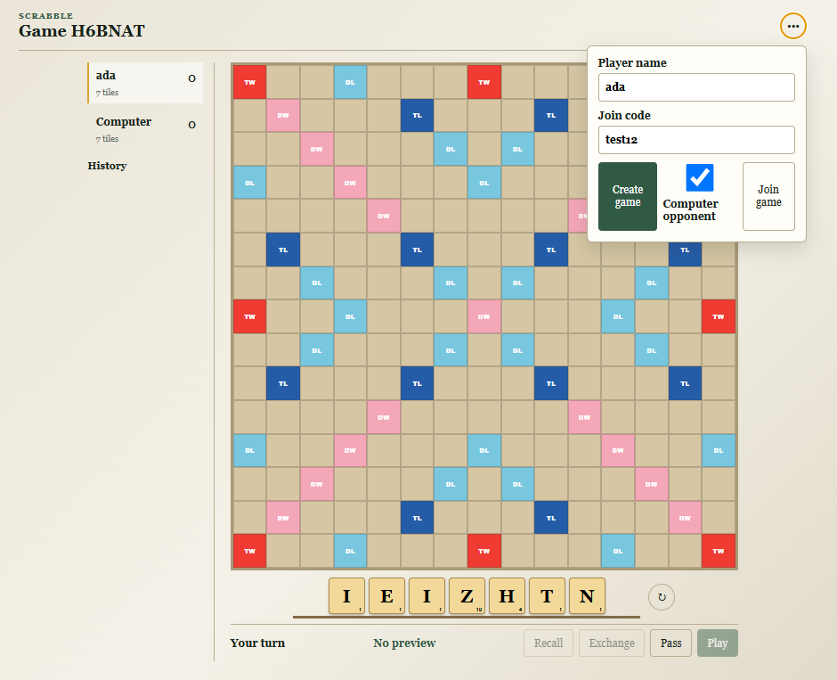
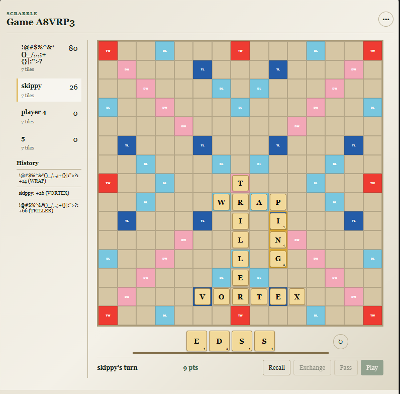
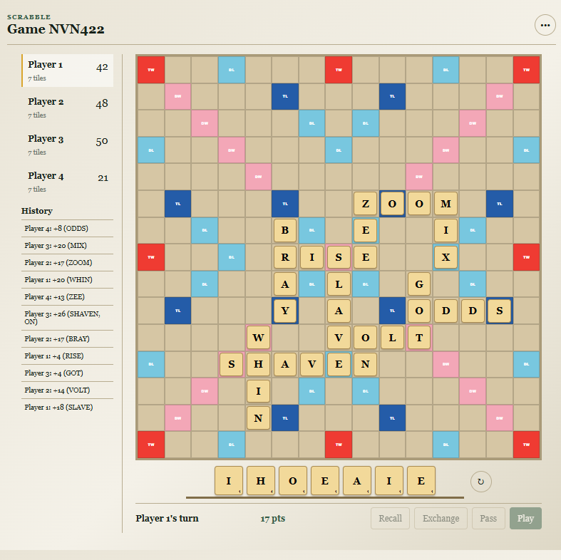
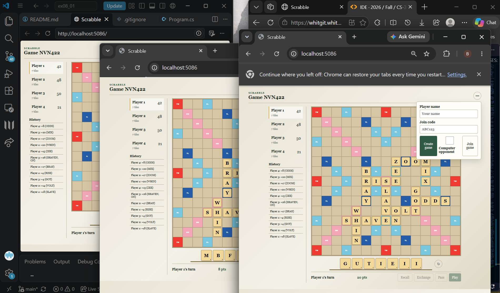

# CS320 Quality Assurance Software Development – ASSIGNMENT #08

## NAME: 	Brynn	Jaklich

## GRADE: 

CATEGORY | POINTS 
-------- | ------
EX08_01  | 25
EX08_02  | 75
TOTAL    | 100 

## BACKGROUND:

https://youtu.be/3A-gqHJ1ENI?si=lfNzLF4enRrTHSTY

## EXERCISES: 

### Assignment Prompt 
**EX08_01** – Fire up your favorite generative AI system
* Gemini: https://gemini.google.com/app?hl=en-GB 
* Cursor: https://www.cursor.com/ 
* Claude.ai: https://claude.ai/new 
* CoPilot/CodePilot: https://github.com/features/copilot 
* ChatGPT: https://chatgpt.com/?ref=dotcom 

Prompt it to create a system, in a specific language:
* Website in HTML/Javascript for a business you’d like to own
* Desktop app in C#/Java to play a game (e.g. chess, scrabble, sudoku)
* Library for managing specific data (e.g. landmarks at a national park)

Copy/paste the code and build/run it.

**EX08_02** – Design and implement 30 tests for your project. Tests can be manual. Report any bugs you find, with 2 formal bug reports.

### EX08_02 Manual Testing

I told AI to write unit tests. I also manually tested and caught a few things that weren't working and told it specifics to fix until it worked. This included the Scrabble cells expanding, words not being recognized, error messages, different colors for diff types of squares, and add a loading symbol when the AI opponent is responding.

#### Formal Bug Report 1

<table style='border:0px'>
  <tr><th>Title</th><td>Unplayed tiles remain on board when switch game</td></tr>
  <tr><th>Description</th><td> See tests 3 and 21. If I leave a tile on the board without submitting and either create a new game or join a different game, it clears the board of the submitted tiles but leaves that tile. It disappears when clicked, on tile recall, or on refresh. </td></tr>
  <tr><th>Status</th><td>Active</td></tr>
  <tr><th>Version Found</th><td>1.0</td></tr>
  <tr><th>Repro Steps</th><td>Create a new game (computer player or not). Place tiles on the board (without clicking 'Play'). Open the menu again and select new game (or join an existing game that was created on a different window).You should still see the tiles you placed in the previous game. They can be removed permanently by clicking them, refreshing, or clicking the 'Recall' button.</td></tr>
  <tr><th>Assigned</th><td>Copilot</td></tr>
  <tr><th>Severity</th><td>3</td></tr>
  <tr><th>Priority</th><td>3</td></tr>
  <tr><th>Environment</th><td>Windows 11, VS Code, Edge, Chrome</td></tr>
  <tr><th>Resolution</th><td>N/A</td></tr>
  <tr><th>Regression Test</th><td>N/A</td></tr>
</table>

#### Formal Bug Report 2
<table style='border:0px'>
  <tr><th>Title</th><td>Text boxes receive special characters</td></tr>
  <tr><th>Description</th><td>You are able to enter special characters into the Player name and Join code text boxes. The join code will return a "Request Failed(404)" error if there is no live game with that code, but it looks like the name is still submitted and checked, so there aren't character protections. The player name can include special characters. I have not tried emojis or other symbols, but special characters can leave it open to SQL Injection. There is no DB at the moment, but better to be safe in case it is added or other stuff is messed up.</td></tr>
  <tr><th>Status</th><td>Active</td></tr>
  <tr><th>Version Found</th><td>1.0</td></tr>
  <tr><th>Repro Steps</th><td>Restore and run Scrabble. Open localhost:5068 and open the menu in the upper right corner of the page. Enter any special characters into the Player name, and it will keep the name if you join or create a game. Entering special characters into the join code will only get a 404 error when trying to join (I don't think the randomized game codes can be created with special characters).<b>Take extra care here</b></td></tr>
  <tr><th>Assigned</th><td>Copilot</td></tr>
  <tr><th>Severity</th><td>2</td></tr>
  <tr><th>Priority</th><td>2</td></tr>
  <tr><th>Environment</th><td>Windows 11, VS Code, Edge</td></tr>
  <tr><th>Resolution</th><td>N/A</td></tr>
  <tr><th>Regression Test</th><td>N/A</td></tr>
</table>

#### Manual tests and bugs found
1. Says immediately on opening something like "session expired; create or join a game." Maybe have a different message for just opening it or fix what's causing the error message to begin with.

2. I can write a join code in the text box, then click create game and it creates a new game with a different code, but the join code I entered is still in the text box.

3. If I leave a tile on the board without submitting and and click new game, it clears the board of the submitted tiles but leaves that tile. When I click it, it disappears. Need to test if it disappears on recall as well.

4. If I have an unsubmitted tile on the board during the computer's turn, if the computer plays on that square (which my tile is on), my tile will cover its tile until I recall or click that tile. 

5. Maybe more of a feature, but I'd like to see the computer's turn history instead of just my turn history and its total points.

6. Also maybe more of a feature but the computer is really good at this, so maybe having easy, medium, and hard modes would be good.

7. I can't actually do multiplayer now unless we play on the same device since it isn't externally hosted. Again, more of a feature.

8. BUG! Tested if I can have two tabs open and play with myself. It says it's "ada's turn" but when I placed a word on Ada's screen, the play button is grayed out and isn't available to click. Refreshed ada's tab and it fixed.

9. I would like to swap tiles if drag one to the other (if both on the board) instead of replacing and the one that was already there being kicked to the letter bank

10. Not a bug but I found out that if I enter a potential word (and don't submit it yet) the potential points tracker changes to 0pts, so I can check if something is a word without submitting and getting an error message.

11. Trying to join a game that doesn't exist gets a "Request Failed (404)" message. Might be better as a user-friendly instruction like "Please join a live game." 

12. Tried entering lots of characters into the text boxes, but there was a max (good). Player name max was 24 characters and Join code max was 6.

13. Tried entering special characters into player name and join code. Join game returns the same "request failed" message. Create game works! My name is !@#$%^&*()_/,.,;+{}|:">? and the join code was automatically set so it didn't care. Join codes are randomized, so it doesn't really matter what you enter if it's not a real code. Unless it's sql inject... There's no DB but I'll try to break stuff.

14. When my tab is smaller, the tile types are really hard to read. All text and elements on page should adjust with window size. Text size could be customizeable. The game board is big so I have to zoom out to see the whole page (including the text and tile bag and buttons underneath the board), but the text becomes very small. Maybe more horizontal options with buttons on the side would help so the board can remain big

15. Tried the name '" return;' and nothing happened when I hit Create except the game was created. Same with other combos.

16. Tried '; and "; in join code and same request failed response.

17. I can plan words but can't "Play" the word if I don't have an opponent. No error message though. Just grayed out message. Impressed it thought of that though

18. When I try to create a game without a player name, a specific error message lets me know "Player name is required. (Parameter 'playerName')" but I don't think I need to know the parameter. 

19. When I try to join an existing game without a player name, it says "Name and join code are required."

20. Join code is case-insensitive. Maybe not a problem but it would help to let the user know or only enter caps in the join code (upper and lower case both map to upper) so the user can see it doesn't matter.

21. When I joined a new (real) game that a second board in different tab had created, the tiles still on the first board from its last game (tiles which were never played/submitted) remained on the first board until I recalled. The number of potential points from that turn was also still there until I recalled.

22. I can add 3 players to a game.

23. Had to refresh one window for the play button to wake up when I place a word. Need to refresh the other two windows after playing a word on one.

24. When I have no tiles in the bag/tray/set (they're all placed on the board), I can click the shuffle button. It doesn't appear to do anything but its not grayed out.

25. I can add a player with one character in the name (specia characters and numbers count, at least I tried 5, 6, and a semicolon).

26. I was able to add 5 players until, on the sixth, a message saying "The game is full" appeared when I tried to join.

27. I had a bunch of tabs open with different players (6 to be exact), 5 of which are on the same game. I refreshed one and it became the most recent game I created with the 6th player. Need to log in to the other players. I cannot go back to the window signed in as the players actually in the game because "The game is full" and there's no session tracking I think to tell it who is who if you leave the tab. It will be forever skippy's turn because skippy can never come back to play!

28. Player 2 disappeared from this game, too.  I also don't think more than two players were given a turn. I'll confirm in a new game. I have a window in VS Code, which doesn't seem to change players when I refresh. If I have two Edge windows open, when I refresh one, it becomes the other (player 2 is lost after refreshing after adding player 3 joined.)

29. I'll try this again with a different browser, so all three players are on different apps (Edge, Chrome, and VS Code). This time I also joined all three players before placing or playing any tiles. I also made Edge create the game (becoming player 1) instead of VS Code, which I did earlier. I notice that I can't see which player you are when looking at a board (no "Player 1 (You)") unless I open the menu to enter a new player name and join/create a different game. This works! All 3 tabs also update immediately when a word is entered.

30. Want to try to add 4th player in the middle of the game but I don't have another browser (besides HP Sure Click Browser, which didn't work, and Respondus Lockdown Browser, which will lock me out of everything). Don't feel like downloading a new one just for this (although I am curious about Brave), so I'll add a player in an Incognito Chrome window. It works! All four players are getting turns and all four are updating correctly. I am just mixing up which is which. (customizable backgrounds, anyone?)

I also notice that the History shows the specific words played by each player in the history, where it only shows yours when playing against a computer.

Notice in the image that player four joined after a whole round.

See the set up:
